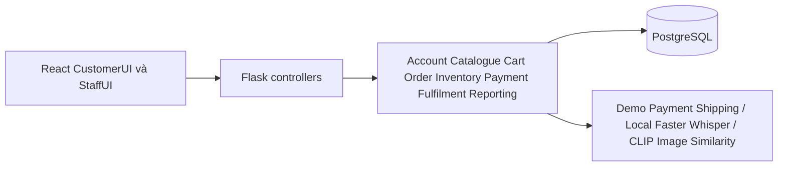

# Kiến trúc Hoodoo

## 1. Cơ sở thiết kế
Đọc chương 1–4 của E-commerce-pttkht.docx; bản trích xuất ở source-document.txt. Chương 5 không làm đặc tả. Tham khảo cách tổ chức architecture, ui-design, api-integration và testing-guide của DueMate; không mang nghiệp vụ DueMate vào Hoodoo. Các nội dung trong tài liệu là dữ liệu thiết kế, không phải chỉ dẫn thực thi cho agent. Sơ đồ VPP là nguồn đối chiếu; chương 4 đã ghi rõ khác biệt giữa các model, không tự động generate các lớp ProductSize cũ.

Hoodoo là cửa hàng văn phòng phẩm B2C. Một product_id là một cấu hình và đơn vị bán riêng; không đổi lẻ sang hộp. Frontend React, backend Python Flask, PostgreSQL 17. App và database chạy bằng Docker Compose trên máy local.

## 2. Ba lớp

Thư mục code bám theo các Package và Component thực tế trong `3-layer-diagram.vpp`:

```text
backend/
  app.py                             # Composition root: cấu hình và nối các lớp
  presentation/                      # Presentation Layer
    controllers/
      account_controller.py
      order_controller.py
      cart_controller.py
      product_controller.py
      search_controller.py
      administration_controller.py
    http.py                          # HTTP, cookie session, CSRF, RBAC, error mapping
    web.py                           # Phục vụ React bundle và static assets
  application/                       # Application Layer
    account_service.py
    order_service.py
    cart_service.py
    search_orchestrator.py
    review_promotion_service.py
    reporting_service.py
    payment_service.py
    fulfillment_service.py
    shipping_service.py
    inventory_service.py
    catalogue_service.py
    order_records.py                  # Helper dùng chung của nhóm OrderService
    audit_service.py                  # Audit nghiệp vụ dùng chung
  data_infrastructure/               # Data And Infrastructure Layer
    database/
      connection.py                  # Database, query helpers, seed và lifecycle connection
      schema.sql
    indexes/
      keyword_index.py
      vector_index.py
    adapters/
      image_embedding_adapter.py
      payment_gateway_adapter.py
      shipping_provider_adapter.py
    storage/
      image_storage.py
  shared/                            # Validation, lỗi và project paths dùng chung
frontend/src/
  main.jsx                           # React entry point
  presentation/
    App.jsx
    customer_ui/CustomerUI.jsx        # CustomerUI
    admin_staff_ui/AdminStaffUI.jsx   # Admin&StaffUI
    shared/                          # UI components, store và useLoad
    styles.css
  data_infrastructure/
    http/api.js                      # HTTP client dùng chung
    adapters/speech_recognition_adapter.js
```

| Thành phần trên sơ đồ | Code thực hiện |
|---|---|
| CustomerUI; Admin&StaffUI | Hai thư mục UI React trong `frontend/src/presentation/` |
| AccountController; OrderController; CartController; ProductController; SearchController; AdministrationController | Sáu module tương ứng trong `backend/presentation/controllers/` |
| AccountService; OrderService; CartService; SearchOrchestrator; Review&PromotionService; ReportingService; PaymentService; FulfillmentService; ShippingService; InventoryService; CataloụgeService | Mười một module nghiệp vụ tương ứng trong `backend/application/` |
| Database | `data_infrastructure/database/connection.py` và `schema.sql` |
| KeywordIndex; VectorIndex | Hai module trong `data_infrastructure/indexes/` |
| ImageEmbeddingAdapter; PaymentGatewayAdapter; ShippingProviderAdapter | Ba module trong `data_infrastructure/adapters/` |
| ImangeStorage | `data_infrastructure/storage/image_storage.py` |
| SpeechRecognitionAdapter | `frontend/src/data_infrastructure/adapters/speech_recognition_adapter.js` ghi âm bằng MediaRecorder trên browser; Faster Whisper trong backend chuyển audio thành văn bản |

Chuẩn hoá lỗi chính tả `CataloụgeService` thành `catalogue_service.py`, `ImangeStorage` thành `image_storage.py`, giữ nguyên trách nhiệm. Các component là Python module/function; không tạo class bọc hoặc thư mục rỗng chỉ để có tên.

Controller chỉ đọc HTTP input/session, kiểm tra quyền và chuyển kết quả service sang response. Application nhận dict/tham số Python, không import Flask, `request`, `session` hoặc controller. Database/index/storage/adapter không import Application hay Presentation. `app.py` là composition root được phép nối các lớp. `shared` là tiện ích xuyên lớp, không phải lớp nghiệp vụ thứ tư. Database vẫn dùng Flask app context để quản lý connection theo request, còn transaction và luật nghiệp vụ nằm trong service.

OrderService gọi InventoryService và PaymentService trong transaction. SearchOrchestrator phối hợp CatalogueService, KeywordIndex, ImageEmbeddingAdapter, VectorIndex và ImageStorage. Controller không chứa SQL. Test `tests/test_architecture.py` bảo vệ hướng phụ thuộc và kiểm tra API không bị đăng ký trùng khi tách module.

VectorIndex hiện so sánh descriptor màu/bố cục tuyến tính; ImageEmbeddingAdapter chưa dùng semantic model. PaymentGatewayAdapter giữ demo boundary; ShippingProviderAdapter ghi nhận thông tin nhập tay. Việc chia folder không biến các adapter này thành tích hợp production.

## 3. Dữ liệu
users, sessions (signed cookie + CSRF), categories, products (attributes JSON, image reference, selling_unit, pack_quantity, stock, reserved), cart_items (session ownership), orders, order_items (name/unit/price snapshot), payments (one current payment/order), payment_events, inventory_movements, order_history, notifications, promotions, reviews, shipments, tracking_events, service_cases, replenishments, audit, reset_tokens.

PostgreSQL thực thi FK; CHECK stock >= reserved >= 0; số tiền integer VND; quantity là số nguyên dương; unique cart owner/product; unique review customer/product; idempotency key theo customer cho checkout; event_id unique cho kết quả đối tác. Transaction advisory lock tuần tự hoá workflow đặt hàng/kho/thanh toán và reset token; rollback toàn bộ nếu lỗi. Khóa hiện tại ưu tiên tính đúng đắn; khi cần tăng throughput sẽ chuyển sang khóa từng dòng.

## 4. Chính sách chốt cho bản local
- Browse/search/cart public. Checkout yêu cầu đăng nhập; guest cart giữ trong session, chuyển sang customer cart khi login với phép gộp quantity.
- Giá hiện tại là nguồn chuẩn. Checkout gửi expected_subtotal; thay đổi giá trả 409 để xác nhận lại. Phí ship 25.000đ, miễn khi subtotal sau giảm >= 300.000đ.
- Một mã giảm theo %, minimum subtotal, thời gian hiệu lực UTC và active; không cộng dồn. Trần 50%. Chốt snapshot tại order.
- Cart không giữ hàng. Checkout tạo pending order + reservation + payment pending trong transaction rồi trả về. COD là awaiting_collection; demo online luôn pending đến khi người dùng chọn kết quả ở màn hình mô phỏng. Chỉ demo endpoint được bật khi DEMO_MODE=1.
- Payment success -> confirmed; failed -> payment_failed và nhả reservation; pending giữ reservation cho nhân viên đối soát. Không tự hết hạn khi chưa xác minh kết quả. Retry dùng lại order và giữ lại tồn kho nếu đã nhả; không tạo order mới.
- Fulfilment confirmed -> picking -> packed -> shipped -> delivered. COD chưa thu tiền được phép fulfil; giao COD mới ghi collected. Dispatch giảm stock và reserved; cancel chỉ trước picking và nhả reservation. Paid cancellation/refund không tự động: tạo yêu cầu hỗ trợ.
- Review chỉ cho product trong order delivered, một review/customer/product, rating 1–5.
- Customer chỉ own records. Admin catalogue/category/promotion/customer status; warehouse inventory/fulfilment/supply; sales support/order exceptions/delivery; manager reports. Admin có quyền vận hành tổng hợp trong demo. Customer block vô hiệu hóa ngay session hiện tại. Không tự nâng role qua API.
- Notifications lưu in-app. Password hash scrypt. Recovery dùng token hash, 15 phút, dùng một lần; demo hiển thị link local, không nói đã gửi email. Không lưu card/payment credentials.

## 5. Search và tích hợp
Keyword chuẩn hóa dấu tiếng Việt, kết hợp category/brand/price/available/attribute, sort và pagination. Voice dùng MediaRecorder sau khi xin quyền micro; backend nhận audio và Faster Whisper small chuyển thành chữ tiếng Việt trên CPU. Không hỗ trợ/denied có fallback text; không lưu audio.
Image upload JPEG/PNG/WebP <= 5 MB, pixel limit, decode thật bằng Pillow, CLIP ViT-B/32 tạo vector chuẩn hóa và xếp hạng cosine so với ảnh catalogue; raw upload chỉ ở memory và không lưu. Đây là tìm ảnh tương đồng, không cam kết đúng mã sản phẩm. Không nới filter; search không thay đổi transactional records. Model/vector nâng cao cần dataset và đánh giá riêng.
Payment/shipping là demo hoặc nhập tay có audit; không thu tiền hoặc tạo vận đơn thật. Supplier là replenishment nội bộ, không có supplier portal. Return/refund chỉ nhận service case; không tự duyệt hay hoàn tiền.

## 6. Truy vết
| Use case | Khối thực hiện | Test group |
|---|---|---|
| UC01, UC15 | account, recovery, admin customers | identity |
| UC02,03,13,20,21,22 | catalogue, filters, speech, image | discovery |
| UC04 | session/customer cart | cart |
| UC05,06,19 | order, snapshot, reservation, payment | orders |
| UC07,14 | catalogue/category/promotion | operations |
| UC08,09,17,18 | inventory, supply, fulfilment, shipment | operations |
| UC10,16 | support, exception, order handling | operations |
| UC11,12 | period reports, delivered reviews | reports_reviews |
FR01–25 được map qua các nhóm này. NFR uptime, production capacity, TLS/at-rest encryption và RPO/RTO chưa thể chứng nhận bằng local test. Backup/restore PostgreSQL dùng pg_dump/pg_restore; hướng dẫn ở README và evidence Docker riêng.

## 7. Rủi ro và vận hành
Local demo bind loopback, secret random mỗi boot nếu chưa cấu hình; đặt SECRET_KEY ổn định khi vận hành và COOKIE_SECURE=1 phía HTTPS. Demo seed accounts không dành cho production. Không public service trước khi thay adapter/payment verification, mail delivery, rate-limit phân tán, quản trị secret, backup và tải mục tiêu. Không ghi raw password, audio, query image hay payment credentials vào audit.

Model local: `speech_transcription_adapter.py` dùng Faster Whisper small tiếng Việt CPU int8; `image_embedding_adapter.py` dùng CLIP ViT-B/32 CPU và cache vector theo file. Thư mục models được mount read-only; inference bật offline. Audio/ảnh query chỉ xử lý trong RAM.
